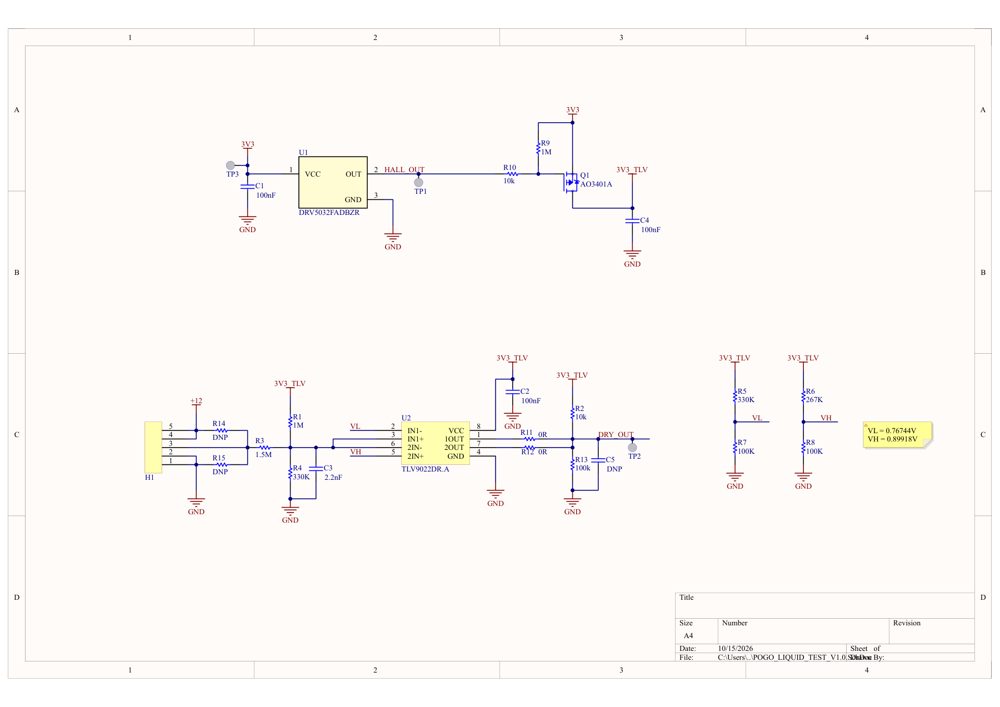

# Mạch phát hiện chất lỏng tại pogo pin

Mạch phục vụ phát hiện nước hoặc chất lỏng tại cụm pogo pin. Thiết kế sử dụng nút cảm nhận, hai comparator và Hall sensor điều khiển nhánh nguồn của khối so sánh.

**Trạng thái: bản thiết kế prototype.** Gói được chuẩn bị ngày 15/10/2026. Chưa có kết quả đo phần cứng, firmware hoặc báo cáo ERC/DRC mới được thực hiện trong lần đóng gói này.



Ảnh xem nhanh được dựng từ PDF nguồn có sẵn. PDF nguồn được xuất lúc 15:05 ngày 15/10/2026, sau lần lưu schematic lúc 15:03 cùng ngày. Chưa thực hiện phép đối chiếu đầy đủ PDF với schematic. Khi có khác biệt, dùng file Altium làm nguồn để kiểm tra và xuất lại PDF.

## Thông tin chính

| Hạng mục | Thông tin |
| --- | --- |
| Project Altium | POGO_LIQUID_TEST_V1.0 |
| Linh kiện trên schematic / PCB chính | 27 / 27 |
| Các khối chính | H1 gồm năm pogo pin; U2 TLV9022DR.A cho khối comparator; U1 DRV5032FADBZR và Q1 AO3401A cho nhánh điều khiển nguồn. |
| Công cụ thiết kế | Altium Designer; phiên bản tạo file chưa được ghi nhận |
| Danh sách linh kiện | Bản tham khảo từ schematic, chưa chốt mua hàng |

## Nội dung thư mục

```text
.
├── README.md
├── .gitignore
├── .gitattributes
├── hardware/
│   ├── altium/             # Project, schematic, PCB và thư viện nguồn
│   ├── schematic/          # PDF nguồn có sẵn
│   └── bom/BOM.md          # Danh sách linh kiện tham khảo
├── docs/
│   ├── HARDWARE.md         # Mô tả khối và bảng chân
│   ├── VALIDATION.md       # Các phép kiểm tra cần thực hiện
│   ├── PACKAGE_NOTES.md    # Phạm vi đóng gói và điểm còn mở
│   └── package-manifest.json
└── images/
    └── schematic-preview.png
```

## Mở thiết kế

1. Tải về hoặc clone toàn bộ repo.
2. Mở [POGO_LIQUID_TEST_V1.0.PrjPcb](hardware/altium/POGO_LIQUID_TEST_V1.0.PrjPcb) bằng Altium Designer.
3. Giữ các file trong `hardware/altium/` cùng nhau; thêm thư viện đi kèm vào thư viện khả dụng nếu Altium yêu cầu.
4. Chạy compile, kiểm tra tham chiếu symbol/footprint và kết nối schematic–PCB trước khi thực hiện ECO hoặc xuất dữ liệu sản xuất.

Nội dung schematic, PCB và thư viện được giữ nguyên. Bản sao `.PrjPcb` được dọn tham chiếu báo cáo sinh tự động và chuyển đường dẫn tài liệu sang tương đối để thuận tiện chia sẻ. Tham chiếu thư viện lịch sử bên trong file thiết kế vẫn cần được kiểm tra khi dùng Update From Libraries.

## Tài liệu đi kèm

- [Schematic PDF](hardware/schematic/POGO_LIQUID_TEST_V1.0_Schematic.pdf).
- [Mô tả phần cứng và bảng chân](docs/HARDWARE.md).
- [Danh sách linh kiện tham khảo](hardware/bom/BOM.md).
- [Kế hoạch kiểm tra](docs/VALIDATION.md).
- [Ghi chú đóng gói](docs/PACKAGE_NOTES.md).
- [Danh sách file và mã SHA-256](docs/package-manifest.json).

## Các mục còn mở

Thư viện đi kèm có đủ tên footprint đang được schematic và PCB sử dụng. Cần xác nhận logic DRY_OUT, việc nối chung hai ngõ ra comparator, đặc tính chất lỏng và điều khiển nguồn bằng Hall sensor.

Cần bổ sung ảnh PCB/board thật, thông tin linh kiện mua hàng, kết quả đo và báo cáo ERC/DRC đúng phiên bản. Các báo cáo cũ, cache, History và dữ liệu xuất chưa được xác nhận không nằm trong gói này. Chưa có Gerber/CPL được chốt để chế tạo.

## Đưa lên GitHub

Đưa **nội dung bên trong thư mục này** vào thư mục gốc của một repo riêng. README và tài liệu dùng tiếng Việt, giữ các thuật ngữ chuyên ngành bằng tiếng Anh. `.gitattributes` giữ nguyên byte của file Altium khi lưu bằng Git.
